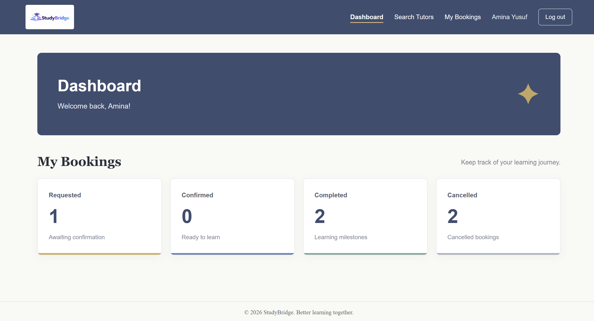
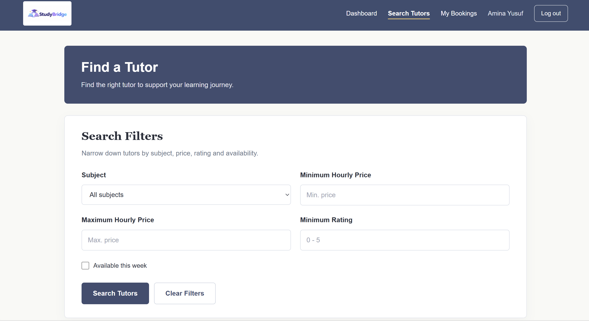
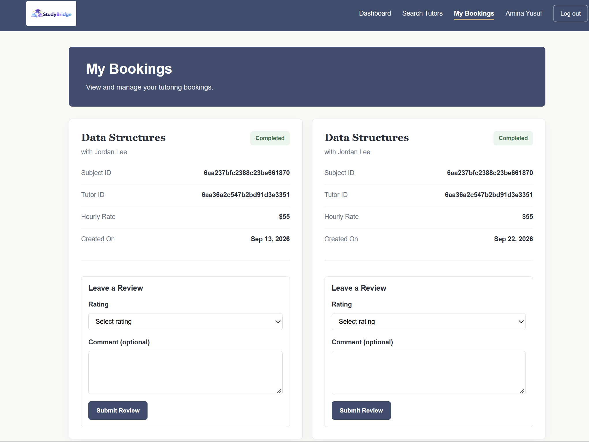
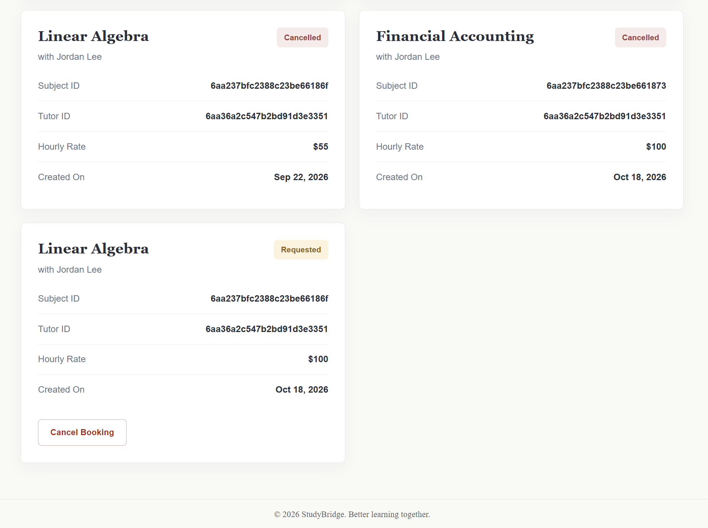
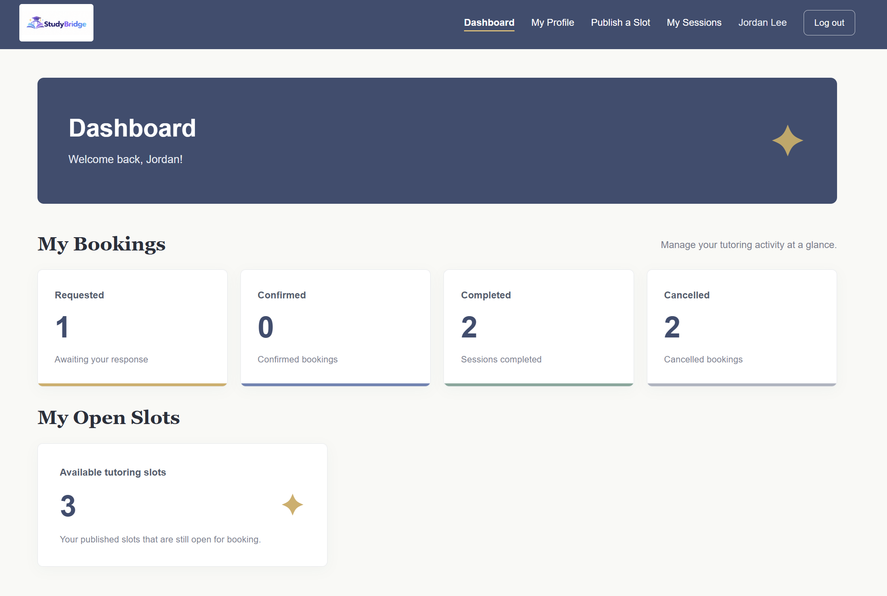
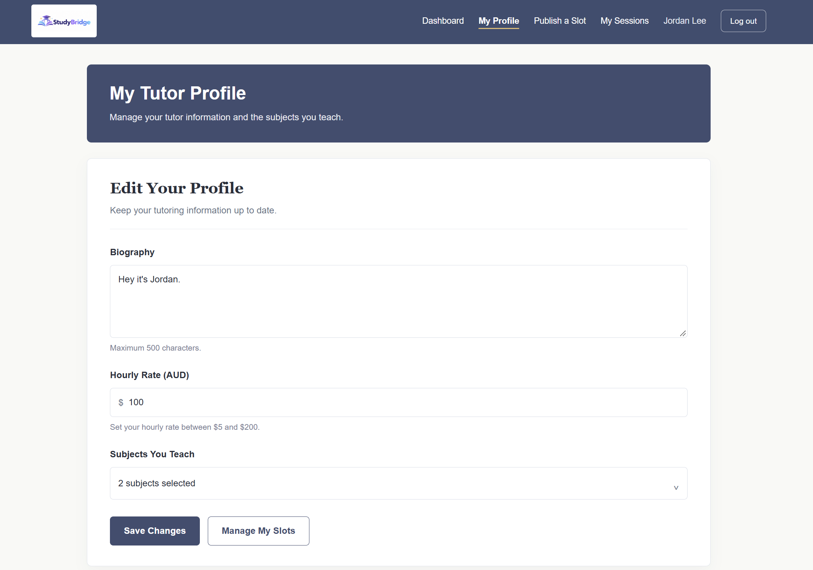
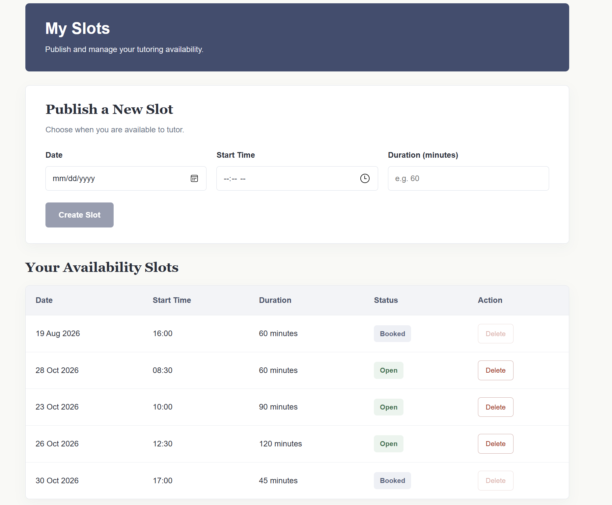
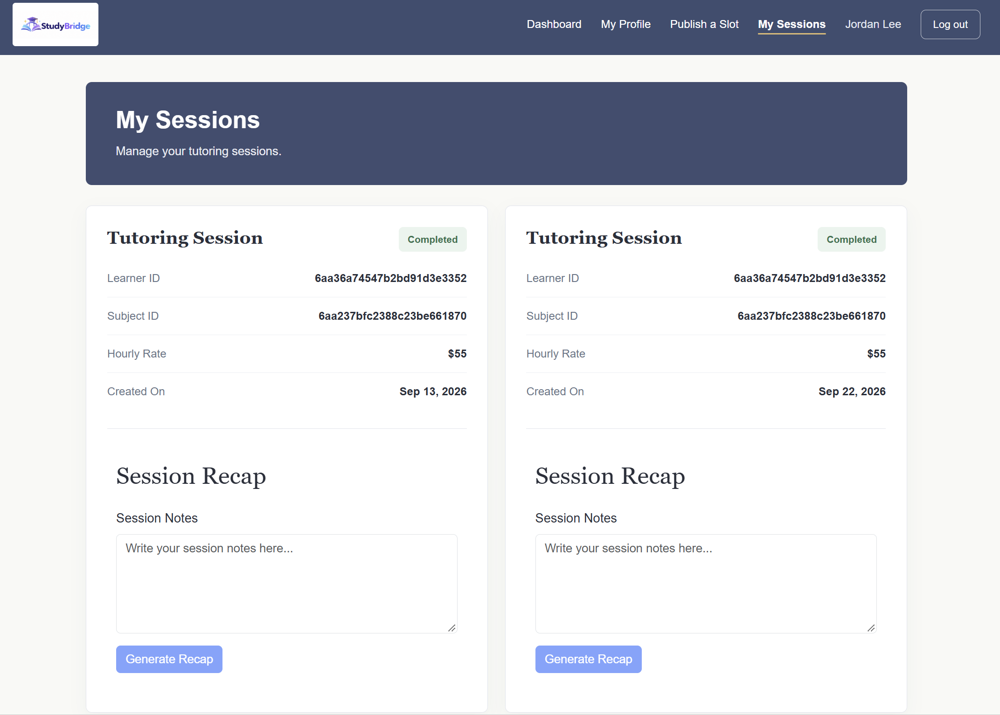

# StudyBridge - Peer Tutoring Platform

StudyBridge is a full-stack web application that helps students find peer tutors, book tutoring sessions and manage their learning activities in one place.

The platform supports learners, tutors and administrators, with features including tutor discovery, availability management, real-time booking updates and AI-generated session recaps using Google Gemini.

## Features

- **User Authentication:** Registration and login with role-based access for learners, tutors and administrators.
- **Tutor Search:** Search for tutors by subject and view their profiles.
- **Availability Management:** Tutors can create and manage their available time slots.
- **Session Booking:** Learners can book tutoring sessions and manage their bookings.
- **Reviews and Ratings:** Learners can leave reviews and ratings for tutors.
- **Real-Time Updates:** Socket.IO provides real-time updates for booking-related activities.
- **AI Session Recaps:** Google Gemini generates session summaries from tutoring notes.

## Tech Stack

| Component | Technologies |
|---|---|
| Frontend | Angular 22, TypeScript, HTML, CSS, Bootstrap 5 |
| Backend | Node.js, Express.js |
| Database | MongoDB, Mongoose |
| Authentication | JWT, bcrypt |
| Real-Time Updates | Socket.IO |
| AI Integration | Google Gemini API |
| Deployment | Google Cloud Compute Engine |

## Screenshots 

### Authentication

Users can create an account as a learner or tutor and log in to access their respective features.

**Login**


**Registration**


### Learner Experience

Learners can search for tutors, filter by subject, price, rating and availability, manage their bookings and leave reviews after completed sessions.

**Learner Dashboard**



**Find a Tutor**




**Manage Bookings & Reviews**





### Tutor Experience

Tutors can manage their profiles, select subjects to teach, set hourly rates, publish availability slots and track their tutoring sessions.

**Tutor Dashboard**



**Tutor Profile**



**Availability Management**



### AI Session Recap

Tutors can enter notes after a completed session and use Gemini AI to generate a session recap.



## Project Structure

```text
FIT2095-studybridge/
├── backend      
├── frontend    
└── README.md                       
```

## Getting Started

### Prerequisites

Install the following before running the application:

- [Node.js](https://nodejs.org/) (v24 or compatible), including npm
- [MongoDB Community Server](https://www.mongodb.com/try/download/community)
- [Git](https://git-scm.com/)
- Angular CLI v22
- [Google Gemini API key](https://aistudio.google.com/apikey) for AI session recaps

To install Angular CLI:

```bash
npm install -g @angular/cli@22
```

### 1. Clone the Repository

```bash
git clone https://github.com/shixhannn/FIT2095-studybridge.git
cd FIT2095-studybridge
```

### 2. Start the Backend

The backend runs at `http://localhost:3000`.

**a) Install dependencies**

```bash
cd backend
npm install
```

**b) Configure environment variables**

Create a `.env` file in the backend directory using `.env.example` as a reference.

Example:

```env
PORT=3000
MONGODB_URI=mongodb://127.0.0.1:27017/studybridge_a2
DB_NAME=studybridge_a2
JWT_SECRET=replace_with_a_secure_random_secret
GEMINI_API_KEY=your_gemini_api_key
SEED_ADMIN_EMAIL=admin@example.com
SEED_ADMIN_PASSWORD=your_admin_password
```

Use your own credentials and keep the `.env` file private.

**c) Start MongoDB**

Make sure the local MongoDB service is running.

**d) Seed the database**

Run the following command to create the initial subjects and administrator account:

```bash
node --env-file=.env seed.js
```

This step is only required during initial setup.

**e) Run the backend**

```bash
node --watch --env-file=.env server.js
```

Keep the terminal open while using the application.

### 3. Start the Frontend

Open another terminal from the repository root.

**a) Install dependencies**

```bash
cd frontend
npm install
```

**b) Run Angular**

```bash
npm start
```

**c) Open StudyBridge**

Visit `http://localhost:4200` in your browser.

The frontend connects to the backend at `http://localhost:3000/api/35623608`. Both servers need to be running.

### 4. Using StudyBridge

Once the application is running, you can register an account and explore the features available to your role.

Learners can search for tutors, view availability, book sessions and leave reviews. Tutors can manage their profiles, availability and tutoring sessions. The application also supports AI-generated session recaps.

## Application Architecture

StudyBridge uses Angular for the frontend and Express.js for the backend. The frontend communicates with the backend through REST APIs.

```text
                 Angular Frontend
                        |
                     REST API
                        |
                        v
                Node.js / Express
                        |
          +-------------+-------------+
          |             |             |
          v             v             v
       MongoDB       Socket.IO     Gemini API
     Data Storage    Real-Time     AI Session
                      Updates        Recaps
```

MongoDB stores user accounts, tutor profiles, subjects, availability slots, bookings and reviews. Socket.IO handles real-time events, while the Gemini API is used to generate session recaps from tutoring notes.

Authentication is handled on the backend using JWT and bcrypt.

## Deployment

StudyBridge was deployed and tested on a Google Cloud Compute Engine virtual machine running Ubuntu.

The deployment involved setting up Node.js and MongoDB, building the Angular application for production, configuring network access and using system services to keep the application running.

The Angular frontend was served through Express, allowing the application and its APIs to be accessed through the same server.

The cloud instance is not kept online continuously, but the application can be run locally using the instructions above.